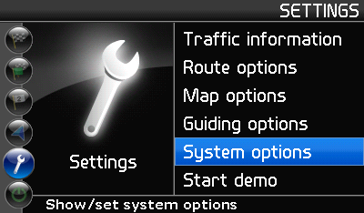
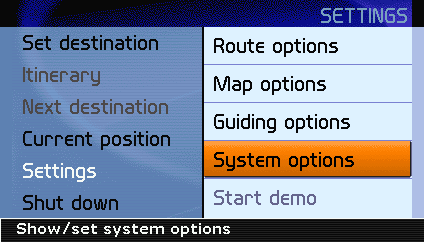
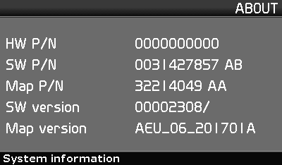
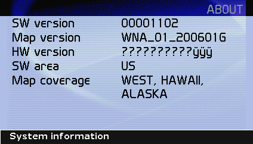

# melco-nav-emu

A QEMU-based emulator for Mitsubishi Electric (MELCO) navigation head units.
One patched `qemu-system-sh4` binary runs each unit's own firmware and map
data. No firmware, disc or map data is included — you need your own dumps.

| QEMU machine | Head unit | Tested disc set | Board model notes |
|---|---|---|---|
| `cup2006` | Volvo RTI MMM+ (CU-P2006) | 2017–18 Europe (`EU-3350-00`, Volvo 32214046) | — |
| `cup28` | Volvo VNS | North America Western (`NA_0900_06A_WESTERN`) | [docs/board-cup28.md](docs/board-cup28.md) |

Each machine models its board's hardware at the register and interrupt level
and runs the disc's own Windows CE kernel, drivers and navigation application.
Approximated hardware behavior is labelled `STUB:` in the sources and listed
under each unit's "Limitations and STUBs" below. The models are tested on
macOS (Apple Silicon); Linux builds the same way but is untested.

One deliberate exception to "hardware only": on a CU-P2006's first power-on
the host-side launcher (`python -m melco_nav_emu.unit`) writes the unit's own map-install
record into its battery RAM, because the served HDD already holds the complete
map install and there is no real install process to run (marked `STUB` there;
see "CU-P2006 unit state" below).

## Screenshots

Both machines' own UI, captured from QEMU's display on screens that show no map
data: `ESC` in the map view opens the unit's settings, and the about screen is
the last entry of the system settings list (opened with the right arrow).

| | `cup2006` (CU-P2006) | `cup28` (CUP28) |
|---|---|---|
| system settings |  |  |
| about |  |  |

CUP28's HW version field reads back as unknown characters, because the machine
does not model it.

## Requirements and building

- macOS with the Xcode command line tools, and Homebrew `glib`, `pixman` and
  `pkg-config` (QEMU's build dependencies). Linux builds the same way but is
  untested.
- Python 3.9 or later.
- Disk space: **CU-P2006** needs about **32 GB free** — the disc ISOs (~9.5 GB)
  plus the virtual HDD (~22 GB, built once from the discs, streamed straight
  into the image). With `CUP2006_HDD_SET=core` the HDD is ~6 GB and carries
  region and parcel data in full, but detailed map data only around
  Gothenburg. **CUP28** needs only its map DVD ISO (~8 GB).

```sh
make qemu    # download the pinned QEMU release, apply qemu/core-patches/, build (minutes)
make test    # offline unit tests, no images needed
```

The patched binary is built at `qemu/src/build/qemu-system-sh4`; nothing is
installed onto your `PATH`. Run `qemu/src/build/qemu-system-sh4 -M cup2006,help`
or `-M cup28,help` to list a board's machine options.

## CUP28 (Volvo VNS)

### Running

```sh
CUP28_DISC="/path/to/Disc A - Western.iso" make boot MODEL=cup28
# or directly:
.venv/bin/python -m melco_nav_emu.cli boot --model cup28 --disc "/path/to/Disc A - Western.iso"
```

The macOS window is resizable and uses CoreAudio. On a new unit the
firmware can initially look for European files; let it finish its first
power-on, close the window, then run the same command again. The guest saves
the North American market setting supplied over MOST and then uses miles and
US English guidance.

### Keys

Use Enter to accept the disclaimer, Escape to go back, and the arrow keys to
navigate:

| key | unit |
|---|---|
| arrows | joystick |
| ENTER | ENTER |
| ESC | BACK |

That is the unit's whole face: no disc-eject or ignition keys are modelled
for this unit, so there are none to press (close the window to end the
session).

### Unit state

The launcher stores the unit's flash and battery-backed SRAM in `build/cup28`
(`flash.bin`, `sram.bin`) plus the extracted firmware image `nk-<sha256>.nb0`.
Set `CUP28_UNIT` to a different directory for a separate unit; `rm -rf` that
directory for a new one.

### Drive replay (GPS and vehicle sensors)

CUP28 has no GNSS radio replay — position arrives over MOST — but it does take
recorded measurements: feed a uniformly sampled sensor CSV with `--track`.
The `sensors.csv` of any shipped scenario works directly:

```sh
.venv/bin/python -m melco_nav_emu.cli boot --model cup28 \
  --disc "/path/to/Disc A - Western.iso" --track scenarios/na-i80/sensors.csv
```

Each row is `t_s,lat_deg,lon_deg,alt_m,speed_kmh,heading_deg,yaw_dps,gps` (the
shipped scenarios sample at 10 Hz). The replay drives the receiver fix, the
cumulative MOST wheel count and the analog gyro from one virtual clock; set
`gps=0` in a row to simulate loss of fix while wheel pulses and gyro continue.
The replay ends at rest with an invalid fix. Without `--track` the receiver is
stationary with a fixed fix in San Francisco. See "GPS drive scenarios" below
for where the scenarios come from, [docs/sensors.md](docs/sensors.md) for the
CSV format and what each column drives, and
[docs/board-cup28.md](docs/board-cup28.md) for the receiver model.

### Limitations and STUBs

- **Receiver is modelled, not simulated.** Default fix: stationary in San
  Francisco. With `--track`, positions come from the CSV, but the satellite
  constellation is a fixed pattern and the receiver clock is made up (STUB): it
  starts at a fixed 2026-11-22 12:00:00 and advances monotonically with virtual
  time.
- **DVD replies** are shaped to pass the guest driver's checks rather than
  taken from a drive protocol (STUB).
- **Audio**: playback DMA is chunked through the host audio backend; KIWI voice
  decoding, speech recognition and text-to-speech are outside the verified
  path.
- **Display**: Q2SD implements the commands the tested firmware uses, with
  fixed frame timing; original panel timing and exact pixel fidelity are
  unverified.
- **No snapshots or reset**: the board devices have no saved state, so `savevm`
  and migration are refused; a reset powers the unit off (start it again).
- Tested with the North America Western disc set only; other disc editions and
  the M-loader update process are out of scope.

## CU-P2006 (Volvo RTI MMM+)

### Installing and running

Put your dumps of the two discs in place:

```
images/dvd/disc1/EU-3350-00_1.ISO
images/dvd/disc2/EU-3350-00_2.ISO
```

```sh
make extract flatten hdd   # disc root files -> images/dvd{1,2}/,
                           # firmware -> images/firmware/, install manifest
make boot                  # first run builds the virtual HDD (~22 GB, once)
```

`make boot` opens the unit's screen in a window that can be resized (the 400x234
panel scales to fit); the unit's serial console prints on the terminal. The
first boot of a new unit is preceded by one short headless power-on (about
30 s, log in `build/unit/first-power-on.log`), in which the guest formats its
battery RAM.

### Keys

The disclaimer is accepted with ENTER, as in the car:

| key | unit |
|---|---|
| arrows | joystick |
| ENTER | ENTER |
| ESC | BACK |
| F10 | disc slot shutter |
| F11 | disc eject button / hand at the slot |
| F12 | ignition off (the unit saves its state and powers down; QEMU exits) |

### Unit state

`build/unit/` holds one head unit's non-volatile memory: its flash, battery
RAM, battery SRAM and EEPROM. It persists across boots like the car's, so
settings and the last position survive. The map itself is on the virtual HDD
in `build/hdd/`, shared by all units.

- `rm -rf build/unit` gives a **new unit with the map installed**: the next
  `make boot` powers it on once to format its memory, then marks the map
  install as complete (STUB: the HDD already holds the complete install, so
  the unit's install record says so).
- `CUP2006_UNIT=<dir> make boot` uses another unit directory.
- `.venv/bin/python -m melco_nav_emu.unit show build/unit` prints what a unit's memory says.

### Disc sets, region and marque

Another disc set is chosen with environment variables:

```sh
export CUP2006_DISC1=/path/NA-2450-00_1.ISO CUP2006_DISC2=/path/NA-2450-00_2.ISO
rm -rf build/hdd build/unit images/dvd1 images/dvd2 images/firmware images/hdd-manifest.json
make extract flatten hdd
make boot
```

The derived files (extracted roots, firmware, manifest, HDD, unit) belong to
one disc set, hence the `rm` when switching. The firmware image is found in
`images/firmware/` by name pattern, whatever version the discs carry.

The car tells the unit its market over the MOST bus; `CUP2006_CARMARKET=<hex>`
sets that byte, which selects **region and marque**. It defaults to the disc
set: `06` when the disc 1 file name contains `NA-`, else `04`.

| value | region | marque |
|---|---|---|
| `04` | Europe | Volvo |
| `06` | North America | Volvo |
| `a0` | Europe | Aston Martin |
| `a1` | North America | Aston Martin |

A North America set (`NA-2450-00`) uses the same disc format and firmware as
the Europe set. Other and older disc sets have not been tested.

### Drive replay (GPS)

Without a recording the GPS receiver has no signal (no fix). Pick one of the
shipped scenarios (see "GPS drive scenarios" below):

```sh
CUP2006_SCENARIO=eu-a4 make boot
```

On a new unit the first fix comes about 35 s after power-on; the recording
ends at about 180 s, after which the receiver reports signal loss. Your own
recordings go in `build/gps/<name>/` (gitignored); `src/melco_nav_emu/gnss/README.md`
explains how they are made and the file formats (`drive.replay` for the radio
chip, `sensors.csv` for the car's wheel and gyro sensors on the same clock).

### Limitations and STUBs

- **3D map car marker.** Navi draws it with the PowerVR MBX 3D core, which is
  not emulated, so the 3D view has no marker. `CUP2006_CARMARKER=1` draws an
  approximation from the guest's geometry with the emulator's own colours and
  shading. The 2D view's marker is the guest's own drawing.
- **Display.** The DU model implements the commands the tested firmware uses,
  plus one behaviour the SH7785 manual does not describe but the guest depends
  on: it raises INTEVT 0x780 with every DIER enable clear (STUB departure).
- **DVD drive.** Only the commands the driver actually issues are modelled
  (sector reads, media-status polls, the command echo and the post-"Loading
  start" queries); the drive answers at once, its reply bytes are values
  chosen to pass the driver's own checks, and replies land at the one fixed
  guest address the driver reads them from (STUBs, each documented at its
  site in `machine/cup2006-dvd.c`).
- **No snapshots or reset.** The board devices have no saved state, so
  `savevm` and migration are refused; a reset powers the unit off (start it
  again).
- **Shared disk.** The guest's writes to the shared HDD image are kept in
  memory for the session only (a unit with its own `build/unit/hdd.img`
  writes to that file). The DVD drive serves ISO images read-only.
- Untested: Linux hosts, big-endian hosts, disc sets other than `EU-3350-00`.

## GPS drive scenarios

Two short recorded drives ship in `scenarios/`, each 3 minutes at 110 km/h on
the straightest 5.5 km of a motorway, picked from OpenStreetMap:

| scenario | road | discs |
|---|---|---|
| `eu-a4` | A-4 southbound, La Mancha, Spain | Europe |
| `na-i80` | I-80 westbound, Bonneville Salt Flats, Utah | North America |

A scenario directory holds:

- `drive.replay`: what the unit's GPS tracking chip measures, satellite by
  satellite — used by **CU-P2006** (`CUP2006_SCENARIO=<name>`, via the
  `gnssreplay=` machine option). Format: the 8 bytes `GNSSIQ1\0`, a
  little-endian u32 frame count and a u32 frame interval in ms, then one
  4096-byte frame per interval holding 32 measurement records of 0x50 bytes
  (one per GPS PRN, first word = PRN, 0 = no signal) followed by 32 navigation
  records of 0x30 bytes (same indexing). The guest's own GPS library computes
  every fix from these.
- `sensors.csv`: the car's sensors on the same clock, one row per sample:
  `t_s,lat_deg,lon_deg,alt_m,speed_kmh,heading_deg,yaw_dps,gps` (format and
  per-board meaning: [docs/sensors.md](docs/sensors.md)). **CUP28**
  consumes this file directly (`--track scenarios/<name>/sensors.csv`): speed
  drives the MOST wheel count, yaw the gyro, and lat/lon the position over
  MOST. **CU-P2006** consumes the wheel and yaw columns (`gpstrack=`); its
  position columns are not used, because the fix comes from `drive.replay`.
- `motion.csv`, `track.gpx`, `route.json`: intermediate products of the
  scenario build (`src/melco_nav_emu/gnss/README.md`).

## Options reference

| option | unit | effect |
|---|---|---|
| `CUP28_DISC` / `--disc` | CUP28 | map DVD ISO |
| `CUP28_UNIT` / `--unit` | CUP28 | unit state directory (default `build/cup28`) |
| `--track` | CUP28 | drive-replay sensor CSV (`gpstrack=`) |
| `--display`, `--audio`, `--qmp` | CUP28 | QEMU display backend, audio backend (`none` to disable), QMP socket |
| `CUP2006_DISC1` / `CUP2006_DISC2` | CU-P2006 | disc ISO paths |
| `CUP2006_UNIT` | CU-P2006 | unit state directory (default `build/unit`) |
| `CUP2006_HDD_SET=core` | CU-P2006 | build and boot the smaller map HDD (`build/hdd/hdd-core.img`) |
| `CUP2006_SCENARIO` | CU-P2006 | replay a shipped GPS scenario |
| `CUP2006_CARMARKET=<hex>` | CU-P2006 | market byte from the car (region/marque table above) |
| `CUP2006_CARMARKER=1` | CU-P2006 | draw an approximation of the 3D car marker (see limitations) |
| `DISPLAY_BACKEND=sdl` / `none` | both | QEMU display backend instead of the per-unit default (`cocoa,zoom-to-fit=on` on macOS, `sdl` elsewhere) |
| `-trace 'cup2006_*'` / `-trace 'cup28_*'` | both | log device activity on stderr; pass after `--`, e.g. `.venv/bin/python -m melco_nav_emu.cli boot -- --trace 'cup28_*'` |

The default `make boot` runs `python -m melco_nav_emu.cli boot`, which
dispatches to the board module in `src/melco_nav_emu/boards/`; extra QEMU
arguments go after `--`, e.g.
`.venv/bin/python -m melco_nav_emu.cli boot --model cup28 -- --trace 'cup28_*'`.

## Layout

```
machine/            board models (cup2006.c and cup28.c) and device sources,
                    symlinked into QEMU's hw/sh4/
qemu/upstream.json  the pinned QEMU release
qemu/core-patches/  machine registration, small SH-4 changes, and
                    deterministic shift=N icount runs (0011-0014,
                    used by bootcheck)
docs/               board and device model notes: docs/board-cup28.md,
                    docs/sensors.md, docs/flash-notes.md (the NOR flash
                    command sets both boards implement)
scenarios/          two 3-minute GPS drives (OpenStreetMap-based, ODbL 1.0:
                    see scenarios/LICENSE)
screenshots/        UI screenshots (plain PNGs, no metadata chunks)
scripts/            build QEMU, extract the discs, carve the firmware,
                    build and verify the HDD
src/melco_nav_emu/  Python package: image parsers, QMP client, CLI,
                    boards/ (per-machine launchers), gnss/ (make GPS
                    scenarios from OpenStreetMap), unit.py (a unit's
                    persistent state)
tests/              offline unit tests
```

## License and trademarks

GPL-2.0-or-later, see [LICENSE](LICENSE). The built `qemu-system-sh4` contains
QEMU, so the binary is GPLv2.

The GPS scenarios in `scenarios/` are derived from OpenStreetMap data and
are licensed separately, under the Open Database License (ODbL) 1.0 — see
[scenarios/LICENSE](scenarios/LICENSE). Map data © OpenStreetMap contributors
(https://www.openstreetmap.org/copyright). Their heights come from the
Copernicus GLO-90 DEM (© Copernicus Programme), retrieved via the Open-Meteo
elevation API (CC BY 4.0, https://open-meteo.com). Everything else in the
repository is GPL-2.0-or-later.

This project is not affiliated with, authorised or endorsed by any of the
companies named here. Volvo and RTI are trademarks of Volvo Car Corporation;
Aston Martin of Aston Martin Lagonda Ltd; Mitsubishi Electric and MELCO of
Mitsubishi Electric Corporation; Renesas and SuperH of Renesas Electronics
Corporation; Microsoft, Windows and Windows CE of Microsoft Corporation;
PowerVR of Imagination Technologies; MOST of the MOST Cooperation. They are
used only to identify the hardware and software this emulator runs.
